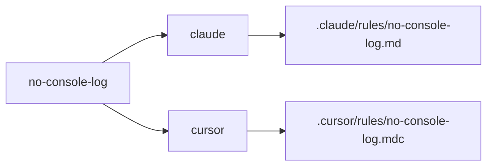
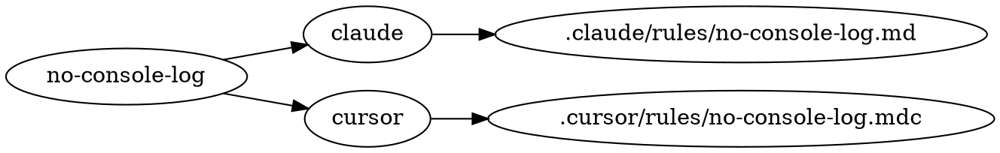

+++
title = "Graph"
description = "See which specs reach which tools, and which files they produce."
weight = 80

[extra]
group = "Workflows"
+++

# graph

Use `graph` to check whether a rule, skill, or other spec reaches the tools you selected. Start with `agnostic-ai graph --spec <name>` when one spec appears to be missing.

Read the row for your spec. A `-` means that tool receives no file; check its supported kinds and your spec's target filters. Output is sorted by spec name, then target.

## Synopsis

```bash
agnostic-ai graph [flags]
```

## Examples

```bash
# Default table view
agnostic-ai graph

# Only the claude column
agnostic-ai graph --target claude

# One spec across every target
agnostic-ai graph --spec no-console-log

# Only rules, as JSON
agnostic-ai graph --kind rule --format json

# Render an SVG of the whole graph
agnostic-ai graph --format dot | dot -Tsvg > graph.svg
```


For the flags, see [graph](@/docs/cli-reference/inspect.md#graph) in the CLI reference.

<details>
<summary>Look up graph output formats</summary>

## Formats

### text (default)

A table with specs as rows and targets as columns. Each cell holds the kind the target writes for that spec, or `-` when it writes nothing.

```text
spec           | claude cursor codex
code-reviewer  | agent  agent  agent
no-console-log | rule   rule   rule
other          | rule   rule   rule
```

### mermaid

A Mermaid diagram starting with `graph LR`, for Markdown viewers that support Mermaid.



### dot

A Graphviz graph. Pipe it to `dot` for SVG or PNG.

```bash
agnostic-ai graph --format dot | dot -Tsvg > graph.svg
```



### json

One record for each file a spec produces, for editor extensions and scripts.

```json
[
  {
    "spec": "no-console-log",
    "kind": "rule",
    "target": "claude",
    "path": ".claude/rules/no-console-log.md"
  }
]
```

</details>

## See also

- [`render`](@/docs/cli-reference/inspect.md#render) prints the file content one spec writes, per target.
- [`explain`](@/docs/cli-reference/inspect.md#explain) lists every file and section one spec feeds.
